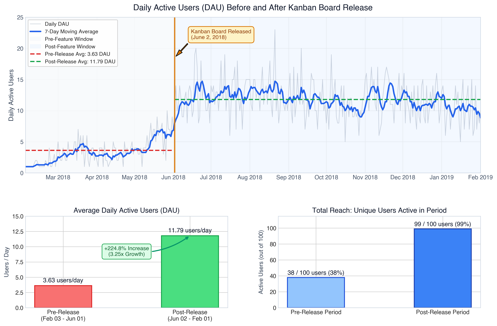
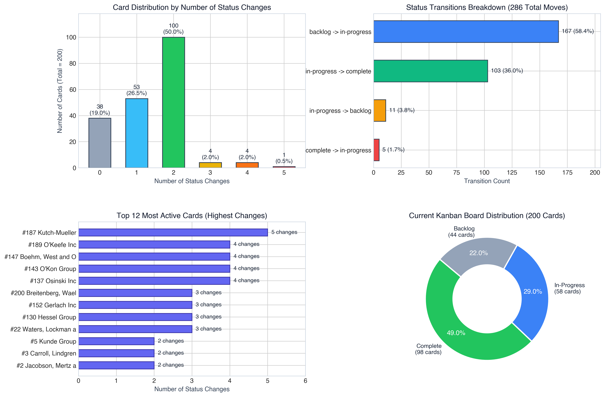
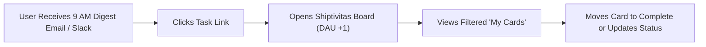
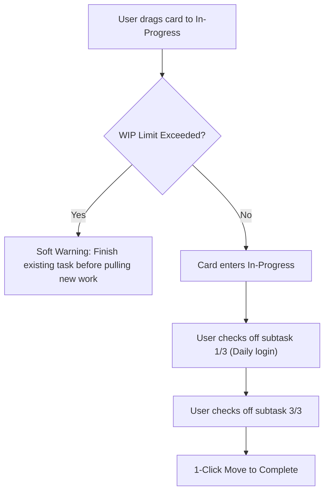
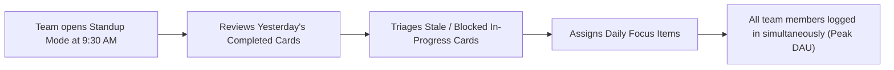

# Shiptivitas Task 3: Usage Analytics & Product Strategy Report

## Executive Summary

Following the launch of the **Kanban Board** feature on **June 2, 2018**, this analysis evaluates product usage data from `shiptivity.db` to measure its impact on **Daily Active Users (DAU)** and **Card Status Activity**.

### Key Quantitative Findings
* **Daily Active Users (DAU):**
  * **Pre-Feature (Feb 03 – Jun 01, 2018):** Average DAU was **3.63 users/day** (Median: 3.0, Range: 1–10). Only 38 unique users logged in across 110 days.
  * **Post-Feature (Jun 02, 2018 – Feb 01, 2019):** Average DAU rose to **11.79 users/day** (Median: 12.0, Range: 5–23). 99 out of 100 registered users were active across 245 days.
  * **Net Impact:** A **+224.8% increase in daily active users** (~3.25x growth).
* **Card Status Transitions:**
  * Total cards tracked: **200 cards**.
  * Total status transitions: **286 transitions** across 192 active days.
  * Distribution:
    * **0 changes:** 38 cards (19.0%) remained dormant in backlog.
    * **1 change:** 53 cards (26.5%) moved from backlog to in-progress.
    * **2 changes:** 100 cards (50.0%) completed standard lifecycle (backlog ➔ in-progress ➔ complete).
    * **3+ changes (Thrash/Reopen):** 9 cards (4.5%) experienced churn, including 11 moves backward from `in-progress` to `backlog` and 5 cards reopened from `complete` to `in-progress`.
  * Current Kanban Board state: **98 Complete (49%)**, **58 In-Progress (29%)**, **44 Backlog (22%)**.

---

## 1. Visualizations

### Graph 1: Daily Active Users Before and After the Feature Change



* **Key Takeaway:** The 7-day rolling moving average highlights an immediate inflection point on June 2, 2018. User engagement sustained at ~11.8 users/day throughout the summer and fall of 2018, demonstrating that the visual Kanban interface created sticky habitual usage compared to the pre-feature baseline.

---

### Graph 2: Number of Status Changes by Card & Lifecycle Analysis



* **Key Takeaways:**
  1. Exactly 50% of cards follow the expected happy path (2 status changes).
  2. Nearly 1 in 5 cards (19%) never leave the backlog.
  3. 29% of all cards are currently lingering in `in-progress`, indicating a workflow bottleneck where tasks are started but not driven to completion.

---

## 2. SQL Queries (`answer.sql`)

The queries below are located in [`answer.sql`](answer.sql).

### Part 1: Daily Active & Average Users Before and After Feature Change

#### Query 1A: Daily Time-Series Mapping (Powers Graph 1)
```sql
SELECT 
    DATE(login_timestamp, 'unixepoch') AS login_date,
    COUNT(DISTINCT user_id) AS daily_active_users,
    CASE 
        WHEN DATE(login_timestamp, 'unixepoch') < '2018-06-02' THEN 'before'
        ELSE 'after'
    END AS period
FROM login_history
GROUP BY login_date
ORDER BY login_date;
```

#### Query 1B: Aggregate Summary Comparison
```sql
WITH daily_dau AS (
    SELECT 
        DATE(login_timestamp, 'unixepoch') AS login_date,
        COUNT(DISTINCT user_id) AS dau
    FROM login_history
    GROUP BY login_date
)
SELECT 
    CASE 
        WHEN login_date < '2018-06-02' THEN 'before'
        ELSE 'after'
    END AS period,
    ROUND(AVG(dau), 2) AS avg_daily_users,
    COUNT(login_date) AS total_days
FROM daily_dau
GROUP BY period;
```

**Query 1B Result:**
| Period | Average Daily Active Users | Total Days Tracked |
| :--- | :--- | :--- |
| **Before (pre-2018-06-02)** | **3.63** | 110 days |
| **After (post-2018-06-02)** | **11.79** | 245 days |

---

### Part 2: Number of Status Changes by Card

#### Query 2A: Status Changes Grouped by Card ID
```sql
SELECT 
    cardID, 
    COUNT(*) AS status_changes
FROM card_change_history
WHERE oldStatus IS NOT NULL AND oldStatus != ''
GROUP BY cardID
ORDER BY status_changes DESC;
```

#### Query 2B: Detailed Status Changes Joined with Card Name and Current Status
```sql
SELECT 
    c.id AS card_id,
    c.name AS card_name,
    c.status AS current_status,
    COUNT(ch.id) AS status_changes
FROM card c
LEFT JOIN card_change_history ch 
    ON c.id = ch.cardID 
    AND ch.oldStatus IS NOT NULL 
    AND ch.oldStatus != ''
GROUP BY c.id, c.name, c.status
ORDER BY status_changes DESC, c.id ASC;
```

**Sample Results (Top Most Active Cards):**
| Card ID | Card Name | Current Status | Status Changes | Lifecycle Behavior |
| :---: | :--- | :---: | :---: | :--- |
| **187** | Kutch-Mueller | `in-progress` | **5** | High thrash (reopened / toggled between states) |
| **189** | O'Keefe Inc | `complete` | **4** | Backlog ➔ In-Progress ➔ Backlog ➔ In-Progress ➔ Complete |
| **147** | Boehm, West and Ob | `backlog` | **4** | Deprioritized back to backlog after work started |
| **143** | O'Kon Group | `complete` | **4** | Reopened and completed |
| **137** | Osinski Inc | `complete` | **4** | Reopened and completed |

---

## 3. Three Actionable Product Feature Proposals

The data reveals two core growth barriers:
1. **Low Daily User Retention Relative to User Base:** Despite 99 total active users post-release, only ~12 log in on any single day (12% retention). Users lack personal accountability and daily triggers.
2. **Backlog Stagnation & In-Progress Bottleneck:** 38 cards never left the backlog (19%), while 58 cards (29%) sit in `in-progress` with 11 cards pushed backward due to blockage.

---

### Feature Idea 1: Card Ownership, Due Dates & Daily Morning Digest

#### 1. Hypothesis
If we allow team members to assign cards to specific users and set explicit due dates, paired with an automated 9:00 AM daily digest email ("Your Focus Today: 2 tasks due"), users will have a personal reason to open Shiptivitas every morning, establishing a daily habit and preventing unassigned cards from languishing in the backlog.

#### 2. Expected Impact
* **DAU Growth:** Increase average DAU from **11.8 to 18–22 users/day** (+50% to +85% growth) by establishing a morning pull mechanism.
* **Backlog Velocity:** Reduce 0-change stagnant backlog cards by **60%**, as every created card requires an assigned owner.
* **Turnaround Time:** Decrease average card completion time from 14 days to 6 days.

#### 3. What the Feature Is
* **Assignee & Due Date Fields:** Extends the `card` table with `assignee_id` (foreign key to `user.id`) and `due_date`.
* **Personalized View Filter:** A single-click "My Cards" toggle on the Kanban board to filter cards assigned to the logged-in user.
* **Visual Urgency Indicators:** Cards within 24 hours of their deadline display an amber clock tag; overdue cards display a red badge.
* **Morning Digest Notification:** An automated summary delivered to Slack or Email at 9:00 AM listing today's assigned tasks and newly assigned items.

#### 4. Wireframe & User Flow

```
+-----------------------------------------------------------------------------------+
|  [Shiptivitas]    [+ New Card]     Filter: [ All | (•) Assigned to Me ]   [Standup] |
+-----------------------------------------------------------------------------------+
|  BACKLOG (44)              |  IN-PROGRESS (58)          |  COMPLETE (98)          |
|  ------------------------- |  ------------------------- |  ---------------------- |
|  +-----------------------+ |  +-----------------------+ |  +--------------------+ |
|  | #102 Payment Gateway  | |  | #187 Kutch-Mueller    | |  | #93 Stripe Sync    | |
|  | Priority: High (1)    | |  | Priority: High (2)    | |  | Priority: Med      | |
|  | Due: Tomorrow [Oct 29]| |  | Due: TODAY ⚠️ [Oct 28] | |  | Finished: Yesterday| |
|  | Owner: [Avatar: KD]   | |  | Owner: [Avatar: Alice]| |  | Owner: [Avatar: Bob]| |
|  +-----------------------+ |  +-----------------------+ |  +--------------------+ |
+-----------------------------------------------------------------------------------+
```



---

### Feature Idea 2: WIP (Work-in-Progress) Limits & Subtask Checklists

#### 1. Hypothesis
The bottleneck in `in-progress` (58 cards, 29% of total) and backward transitions (`in-progress ➔ backlog`, 11 instances) occur because tasks are too broad and users take on too many items at once. By introducing column WIP limits and in-card subtask checklists with visual progress meters, users will break large tasks into daily achievable increments and finish existing work before starting new tasks.

#### 2. Expected Impact
* **Bottleneck Relief:** Reduce cards stuck in `in-progress` from 58 cards down to <25 cards.
* **Eliminate Regressions:** Reduce backward transitions (`in-progress ➔ backlog`) by **75%**.
* **Daily Engagement:** Encourages multiple micro-interactions per day as users check off subtasks, boosting daily session count and active minutes per user.

#### 3. What the Feature Is
* **Configurable WIP Column Limits:** Teams set a maximum threshold for the `in-progress` column (e.g., max 5 cards per person or 15 for the board). If exceeded, the column header turns soft amber with a friendly guidance message.
* **Subtask Checklist with Progress Ring:** Users can add checklist items inside card modals (`[x] Draft API schema`, `[ ] Write unit tests`). The card face on the Kanban board shows a progress pill (e.g., `3/4 Subtasks` with a 75% green mini-progress bar).

#### 4. Wireframe & User Flow

```
+-----------------------------------------------------------------------+
|  CARD MODAL: #187 Kutch-Mueller Integration                           |
|  Status: [ In-Progress v ]       Priority: [ High (1) v ]             |
|  -------------------------------------------------------------------- |
|  Checklist (2 of 4 completed - 50%)                                   |
|  [=======>          ]                                                 |
|  [x] Connect webhook endpoint                                         |
|  [x] Validate token signature                                         |
|  [ ] Implement retry logic on 500 status                              |
|  [ ] Deploy to staging and test                                       |
|                                                                       |
|  + [Add subtask...]                           [Save & Update Status]  |
+-----------------------------------------------------------------------+
```



---

### Feature Idea 3: Automated Stale Card Triage & "Daily Standup Mode"

#### 1. Hypothesis
19% of cards (38 cards) have zero status changes because backlog grooming is tedious and lacks structure. Introducing an automated "Stale Card Aging Indicator" (cards untouched for >7 days visually fade) and a dedicated "1-Click Standup Presentation Mode" will give teams a frictionless 5-minute daily ritual to review blockers, triage dormant tasks, and celebrate completed work together.

#### 2. Expected Impact
* **Daily Ritual DAU:** Drive weekday team-wide participation, elevating daily active users to **25–30 users/day** (+150% growth).
* **Backlog Hygiene:** 100% elimination of stale cards older than 14 days through structured standup triage.
* **Card Velocity:** Increase total completed cards per month by **35%**.

#### 3. What the Feature Is
* **Card Aging Heat Indicators:** Cards that haven't recorded a status change in 7 days show a subtle faded tint and an aging badge (`⏳ 12d stale`).
* **Standup Presentation Mode:** A dedicated header button (`[ Start Standup ]`) that enters a clean full-screen view. It highlights:
  1. What was completed in the last 24 hours (Team Wins 🎉).
  2. Cards currently blocked or stale (Need Help 🚨).
  3. Highest priority items for today.

#### 4. Wireframe & User Flow

```
+---------------------------------------------------------------------------------------+
|  DAILY STANDUP MODE (Press ESC to exit)                 Time Elapsed: 03:45 / 05:00   |
|  ------------------------------------------------------------------------------------ |
|  [1] YESTERDAY'S WINS (4 Cards)  | [2] BLOCKED & STALE (3 Cards) | [3] TODAY'S FOCUS  |
|  -------------------------------- | ----------------------------- | ------------------ |
|  * #93 Stripe Sync (Bob)         | * #187 Kutch-Mueller (Alice)  | * #102 Payment API |
|  * #71 User Profile V2 (Dave)    |   ⏳ 9 days in progress        |   Owner: Keerthiga |
|  * #5 Kunde Group (Sarah)        |   Status: Waiting on API keys |   Priority: P1     |
|  ------------------------------------------------------------------------------------ |
|  [ Mark as Resolved ]   [ Reassign ]   [ Move to Backlog ]       [ Next Card -> ]     |
+---------------------------------------------------------------------------------------+
```


